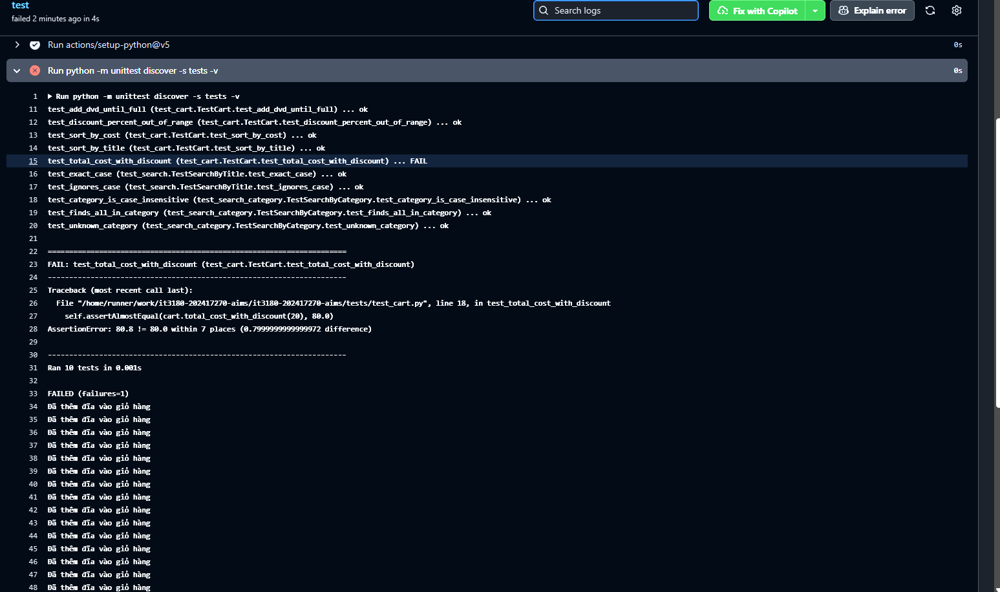

# Trả lời câu hỏi thảo luận – Lab 05

## 1. Ưu và nhược điểm của upstream first so với release first

| | Release first (học phần) | Upstream first (Microsoft Release Flow) |
|---|---|---|
| Thứ tự | Tạo `hotfix/*` từ `release/*`, sửa ở release rồi lan truyền sang `master` và các release khác | Sửa trên `master` trước, rồi `cherry-pick` sang `release/*` |
| Ưu điểm | Sửa và kiểm thử ngay trên đúng phiên bản bị lỗi, nên khẩn cấp xử lý nhanh, không bị ảnh hưởng bởi tính năng mới chưa ổn định ở `master` | `master` luôn có bản sửa, không thể quên; review một lần ở nơi chính; bản vá đến release đã được kiểm chứng trên nhánh phát triển |
| Nhược điểm | Dễ quên đưa bản sửa về `master`, khiến lỗi tái xuất ở các bản sau (regression); phải tự theo dõi bằng công cụ | Bản sửa trên `master` có thể phụ thuộc mã mới mà release chưa có, nên cherry-pick khó hoặc xung đột; chậm hơn khi cần sửa gấp |
| Phù hợp | Phát hành định kỳ, nhiều bản song song, cần vá nhanh | Nhóm lớn, `master` luôn ở trạng thái ổn định |

Trong lab này, hotfix được tạo từ `release/lab04` (release first) rồi lan truyền sang `master` và `release/lab05` bằng `cherry-pick -x`. Dòng `(cherry picked from commit ...)` giữ dấu vết nguồn gốc để kiểm toán sau này.

## 2. Nếu quên lan truyền bản sửa sang `release/lab05`, lệnh nào ở Phần F phát hiện?

- `git log --all --oneline --grep "cherry picked from commit <FIX_SHA>"`: chỉ ra **một** bản cherry-pick (ở `master`) thay vì hai, nên thiếu bản ở `release/lab05`.
- `git cherry -v origin/release/lab05 origin/release/lab04`: dòng bản sửa có dấu `+` ("chưa có bản tương ứng") thay vì `-`.
- `git tag --contains <FIX_SHA>`: chỉ liệt kê `v1.0.1`, không có `v1.1.0`.
- Vòng lặp chạy `search_by_title` trên các phiên bản: `v1.1.0` in `0` thay vì `1`, tức hành vi vẫn sai.

Lệnh đáng tin nhất là kiểm tra hành vi bằng test hoặc chạy thật, vì ba lệnh đầu chỉ dựa trên lịch sử commit.

## Thực hành CI cơ bản với GitHub Actions

### Mục đích
Mỗi PR tự động chạy toàn bộ unit test trên môi trường sạch (Ubuntu, Python 3.12), để lỗi bị phát hiện trước khi merge. Đây là bước đầu của CI/CD và là một dạng **kiểm soát thay đổi** tự động: reviewer không cần tự chạy test.

### Các bước đã làm
1. Thêm `.github/workflows/ci.yml` qua PR (`topic/ci-unit-tests`): chạy khi có PR vào `master` hoặc `release/**` và khi push lên `master`, job `test` chạy `python -m unittest discover -s tests -v`.
2. Bật **Require status checks to pass** trong ruleset của `master`, chọn job `test`.
3. Tạo nhánh `bugfix/ci-demo` làm hỏng `total_cost` (thêm `+ 1`) rồi mở PR.
4. CI báo đỏ, nút Merge bị khoá. Đóng PR không merge và xoá nhánh.

### Ảnh minh hoạ

**Log của job `test` trên PR `bugfix/ci-demo`.** Job báo lỗi (`failed`): `test_total_cost_with_discount` FAIL với `AssertionError: 80.8 != 80.0`, tổng cộng 10 test chạy và 1 test lỗi (`FAILED (failures=1)`). Số `80.8` cho thấy phép `+ 1` làm lệch tổng tiền, nên test bắt được ngay.

### Nhận xét
- Test là rào chắn đầu tiên: một thay đổi sai nhỏ (`+ 1`) cũng bị bắt, trong khi khi review bằng mắt rất dễ bỏ sót.
- Kết hợp branch protection (Require PR) và required check, `master` chỉ nhận mã đã qua test.
- **Hạn chế:** `ci.yml` chỉ có trên `master`. `release/lab04` và `release/lab05` không có file này nên PR nhắm vào hai nhánh đó **không chạy CI**. Muốn có phải cherry-pick `ci.yml` sang từng nhánh qua PR có base tương ứng.

## Ghi chú thực hiện

### Các bước và PR của Lab 05

| Bước | Nhánh | Nội dung | Base |
|---|---|---|---|
| Issue | (#24) | `search_by_title is case-sensitive (affects v1.0.0)` | – |
| A | `feature/search-by-category` (#25) | Thêm `search_by_category` ở phía trên `search_by_title` | `master` |
| A | `topic/prepare-release-1.1.0` (#26) | Nâng version 1.1.0, CHANGELOG | `master` |
| A | `release/lab05` | Cắt từ `master`, chưa gắn tag | – |
| B | – | Tái hiện lỗi trên `v1.0.0` bằng worktree: `search_by_title(..., 'lion')` ra `[]` | – |
| C | `hotfix/search-case-insensitive` (#27) | 2 commit: fix kèm test (`Refs #24`) và nâng version 1.0.1; gắn tag `v1.0.1` | `release/lab04` |
| D | `hotfix/search-case-insensitive-master` (#28) | `cherry-pick -x` bản sửa, thêm `[1.0.1]` vào CHANGELOG, `Fixes #24` | `master` |
| E | `hotfix/search-case-insensitive-lab05` (#29) | `cherry-pick -x` bản sửa; gắn tag `v1.1.0` | `release/lab05` |
| Mở rộng | `topic/ci-unit-tests` (#30) | GitHub Actions | `master` |

Bản sửa được tách thành commit riêng khỏi commit nâng version, để chỉ cherry-pick phần cần thiết (số `1.0.1` chỉ đúng cho dòng 1.0.x). `release/lab05` chưa gắn tag ở Phần A vì cần nhận bản sửa trước; nếu gắn ngay thì sẽ phải phát hành thêm `v1.1.1`.

### Kết quả kiểm toán

| Kiểm tra | Kết quả |
|---|---|
| `git log --all --grep "cherry picked from commit <FIX_SHA>"` | 2 bản (`master` và `release/lab05`) |
| `git tag --contains <FIX_SHA>` | `v1.0.1` |
| `git cherry -v origin/master origin/release/lab04` | `-` cho commit fix; `+` cho commit nâng version và revert, đúng ý vì chỉ thuộc dòng 1.0.x |
| `search_by_title(..., 'lion')` trên `v1.0.0` / `v1.0.1` / `v1.1.0` / `master` | `0` / `1` / `1` / `1` |
| Tag | `v0.1.0`, `v0.2.0`, `v0.3.0`, `v1.0.0`, `v1.0.1`, `v1.1.0` |

### Sự cố và sai khác so với slide
- `git diff --stat v1.0.0 v1.0.1` hiện **5 file** thay vì 4. File thừa là `docs/answers-lab04.md`, do ở Lab 04 hai PR trả lời bị gắn nhầm base: một PR dựa trên `master` bị merge vào `release/lab04` và kéo theo `sort_by_title`, `sort_by_cost`. Đã khắc phục bằng `git revert -m 1` qua PR #23; lịch sử `release/lab04` vẫn còn các commit đó nhưng nội dung đã sạch, nên được chấp nhận vì không viết lại lịch sử đã chia sẻ.
- Số test của repo khác slide (slide ghi 8 test OK ở `master`) vì cách cài đặt khác.
- Dòng tiếng Việt trong `print` cần `PYTHONIOENCODING=utf-8` khi chạy trên console Windows.
