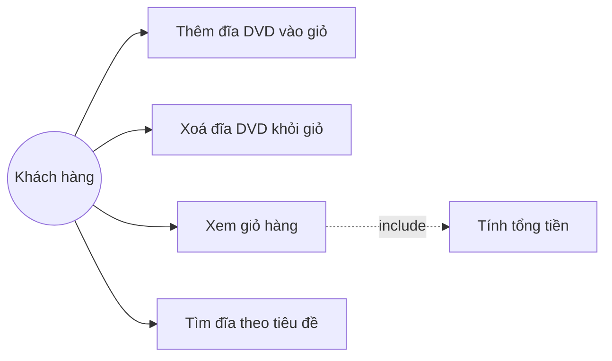

# Use case – AIMS-mini

## Biểu đồ

## Mô tả

| Use case | Mô tả | Ghi chú |
|---|---|---|
| Thêm đĩa DVD vào giỏ | Khách thêm một đĩa vào giỏ hàng | Giỏ chứa tối đa 20 đĩa |
| Xoá đĩa DVD khỏi giỏ | Khách bỏ một đĩa khỏi giỏ | Báo nếu đĩa không có trong giỏ |
| Xem giỏ hàng | In danh sách đĩa và tổng tiền | `Cart.print_cart()` |
| Tìm đĩa theo tiêu đề | Lọc đĩa theo từ khoá | `search_by_title()` |
| Tính tổng tiền | Cộng giá các đĩa trong giỏ | `Cart.total_cost()` |
